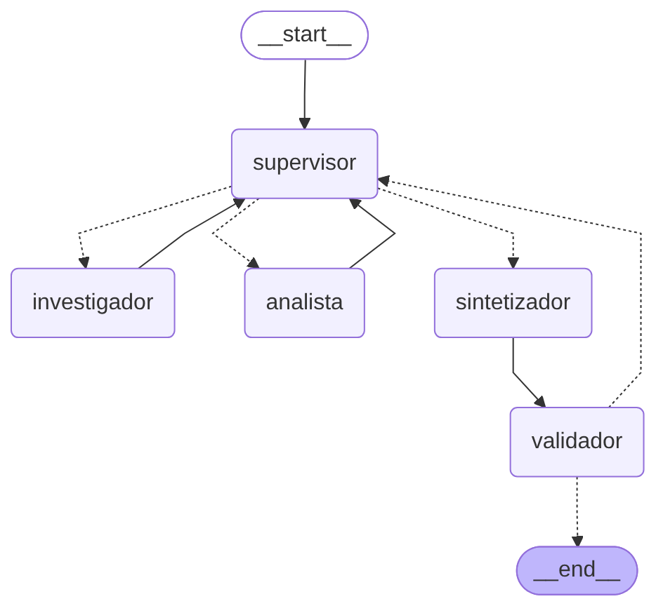
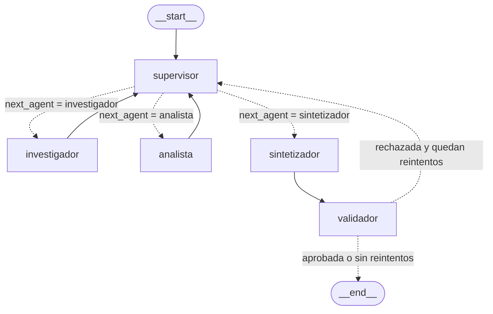

# Orquestador multi-agente de análisis e investigación

Prototipo de un sistema multi-agente jerárquico construido con LangGraph. Un **Supervisor** recibe una consulta que requiere dos dominios de especialización, delega dinámicamente en un **Agente Investigador** (búsqueda documental) y un **Agente Analista** (cálculo y análisis de sentimiento), evalúa cada aporte con una rúbrica, y solo da la tarea por terminada cuando la síntesis final pasa un **Validador** automático.

El caso de uso es el análisis de desempeño de Nubeteca, una empresa SaaS ficticia, a partir de su base documental: informes trimestrales, una nota de prensa con cifras preliminares contradictorias, una política de precios y reseñas de clientes.

## Topología del grafo



El diagrama se genera desde el grafo compilado con `graph.get_graph().draw_mermaid_png()` (`python main.py --diagrama`). La versión Mermaid, que GitHub renderiza directamente:



Las flechas punteadas son aristas condicionales. Las funciones de enrutamiento declaran sus destinos posibles con `Literal`, y LangGraph usa esa anotación para validar el grafo y dibujarlo:

```python
def enrutar_supervisor(state: OrchestratorState) -> Literal["investigador", "analista", "sintetizador"]:
    return state["next_agent"]

def enrutar_validacion(state: OrchestratorState) -> Literal["supervisor", "__end__"]:
    ...
```

### Por qué una topología jerárquica con supervisor

- **Control de flujo centralizado**: un solo nodo decide quién interviene, así que el orden de ejecución no está fijado en el código. Si el análisis revela que faltan datos, el supervisor vuelve a delegar en el investigador; con un pipeline lineal (investigador → analista → fin) eso sería imposible.
- **Un único punto de evaluación**: el supervisor aplica la rúbrica a cada aporte antes de decidir el siguiente paso, en lugar de que cada agente juzgue el trabajo de los demás.
- **Especialistas simples y reemplazables**: cada especialista solo resuelve su tarea y vuelve al supervisor. Agregar un tercer especialista implica un nodo nuevo y una opción más en el `Literal`, sin tocar a los demás.
- **Frente a una red de agentes que se comunican entre sí**, esta topología hace que el recorrido sea predecible, depurable y fácil de acotar con un contador de pasos.

## Estructura del repositorio

| Archivo | Contenido |
|---|---|
| `state.py` | Esquema del estado compartido `OrchestratorState` y tipos `Contribucion`, `Decision` y `ResultadoValidacion` |
| `agents/supervisor.py` | Nodo Supervisor: rúbrica, decisión con salida estructurada y criterio de suficiencia |
| `agents/research_agent.py` | Agente Investigador (`create_react_agent`) y sus herramientas de búsqueda |
| `agents/analyst_agent.py` | Agente Analista (`create_react_agent`) y sus herramientas de cómputo |
| `agents/synthesizer_agent.py` | Nodo Sintetizador: redacta la respuesta final solo con los aportes |
| `agents/common.py` | Ejecución de un especialista y registro de su contribución en el estado |
| `validation.py` | Nodo Validador y enrutamiento posterior |
| `graph.py` | Construcción del `StateGraph` y exportación del diagrama |
| `main.py` | Ejecución por consola con el flujo paso a paso y guardado de la traza |
| `demo_delegacion.ipynb` | Notebook que demuestra el flujo de delegación |
| `knowledge_base/documentos.json` | Base documental simulada que consulta el investigador |
| `trazas/` | Trazas de ejecución en `.json` y `.log` |
| `docs/` | Diagrama del grafo en `.png` y `.mmd` |

## Estado compartido (`state.py`)

`OrchestratorState` hereda de `MessagesState` (que ya es un `TypedDict`) y agrega los campos que permiten rastrear qué agente aportó qué información:

| Campo | Tipo | Reducer | Para qué sirve |
|---|---|---|---|
| `messages` | `list[AnyMessage]` | `add_messages` | Conversación global; cada mensaje lleva el `name` del agente que lo generó |
| `consulta` | `str` | reemplazo | Consulta original del usuario |
| `next_agent` | `Literal["investigador", "analista", "sintetizador"]` | reemplazo | Destino elegido por el supervisor; lo lee la arista condicional |
| `instruccion_actual` | `str` | reemplazo | Instrucción autocontenida para el especialista elegido |
| `delegaciones` | `int` | reemplazo | Contador de delegaciones; base del criterio de parada |
| `contribuciones` | `list[Contribucion]` | `operator.add` | Historial de aportes: agente, iteración, instrucción, salida, herramientas usadas y evidencia devuelta por las herramientas |
| `decisiones` | `list[Decision]` | `operator.add` | Historial de decisiones del supervisor con su evaluación según la rúbrica y si fue forzada |
| `validaciones` | `list[ResultadoValidacion]` | `operator.add` | Resultado de cada intento de validación |
| `feedback_validacion` | `str` | reemplazo | Problemas detectados por el validador, que leen el supervisor y los especialistas |
| `respuesta_final` | `str` | reemplazo | Respuesta del sintetizador |
| `task_completed` | `bool` | reemplazo | `True` solo si la validación aprobó |

Las listas con `operator.add` son de solo agregado: ningún nodo puede borrar ni pisar el aporte de otro, y cada contribución queda asociada a su autor y a su iteración. Así no se pierde contexto entre las invocaciones asíncronas de los distintos agentes.

## Agentes y herramientas

Cada especialista es un agente ReAct creado con `create_react_agent`, con un prompt de rol y **herramientas acotadas a su dominio**: el investigador no puede calcular y el analista no puede buscar.

| Agente | Herramientas | Responsabilidad |
|---|---|---|
| Investigador | `buscar_documentos(consulta, max_resultados)`, `leer_documento(doc_id)` | Encontrar cifras y textos con su fuente (doc_id, tipo, fecha) e informar conflictos entre documentos |
| Analista | `calcular_variacion_porcentual`, `calcular_estadisticas`, `analizar_sentimiento`, `evaluar_expresion` | Procesar los datos del investigador: crecimiento, estadísticas, sentimiento de reseñas y cuentas aritméticas |
| Supervisor | Salida estructurada `DecisionSupervisor` | Elegir el siguiente paso y evaluar cada aporte con la rúbrica |
| Sintetizador | Ninguna | Redactar la respuesta final usando solo los aportes y citando las fuentes |

- `buscar_documentos` busca por palabras clave sobre la base documental, sin tildes ni palabras vacías, y prioriza las coincidencias en el título.
- `analizar_sentimiento` usa un léxico de palabras positivas y negativas en español que contempla negaciones ("no es mala"), y devuelve el detalle por reseña más un resumen.
- `evaluar_expresion` evalúa aritmética recorriendo el árbol sintáctico de Python (`ast`), sin `eval`, y solo admite números y operadores.

### Control del contexto de cada agente

Para evitar la contaminación de contexto, **ningún especialista recibe el historial completo**:

- El **investigador** recibe solo la instrucción del supervisor y, si existe, la observación del validador.
- El **analista** recibe la instrucción y únicamente los aportes del investigador (su salida y los documentos que leyó), no las decisiones del supervisor ni otros mensajes.
- El **supervisor** ve la consulta y un resumen de los aportes, no los mensajes internos de cada agente ReAct.

Por eso el supervisor tiene que escribir instrucciones autocontenidas, como indica su prompt.

## Flujo de supervisión

El supervisor responde con un objeto estructurado (`with_structured_output`):

```python
class DecisionSupervisor(BaseModel):
    evaluacion_ultimo_aporte: str
    razonamiento: str
    siguiente: Literal["investigador", "analista", "finalizar"]
    instruccion: str
```

Si un aporte no cumple la rúbrica, el supervisor puede re-delegar al mismo especialista con una instrucción que diga qué corregir; así se implementa el refinamiento de outputs.

### Rúbrica de validación del supervisor

Antes de elegir `finalizar`, el supervisor verifica:

1. **Cobertura**: cada parte de la consulta tiene datos y, si corresponde, un cálculo.
2. **Trazabilidad**: cada cifra indica su documento de origen.
3. **Conflictos resueltos**: ante cifras contradictorias se usa la fuente oficial más reciente.
4. **Cómputo verificable**: todo cálculo lo hizo el analista con una herramienta.
5. **Consistencia**: el analista usó exactamente las cifras del investigador.

### Validador

Además de la rúbrica del supervisor, el nodo `validador` hace controles deterministas sobre el resultado, sin depender del modelo:

- Al menos un aporte del investigador y uno del analista usaron herramientas.
- La respuesta final no está vacía y cita al menos una fuente con su `doc_id`.
- **Cada cifra de la respuesta final aparece en algún aporte o resultado de herramienta.** El validador interpreta formatos como `2.116.000`, `15,0 %` o `6205.28`, ignora años y números menores a 10, y tolera diferencias de redondeo. Una cifra que el sintetizador inventó o calculó por su cuenta hace que la validación falle.

Si la validación falla, el grafo vuelve al supervisor con los problemas en `feedback_validacion`, para que delegue la corrección al especialista que corresponda.

### Criterios de parada

| Mecanismo | Valor | Efecto |
|---|---|---|
| `MAX_DELEGACIONES` | 6 | Al alcanzarlo, el supervisor pasa a la síntesis sin consultar al modelo (decisión marcada como `forzada`) |
| `MAX_REINTENTOS_VALIDACION` | 1 | Si la validación vuelve a fallar, el grafo termina y agrega una advertencia a la respuesta |
| `RECURSION_LIMIT_GRAFO` | 30 | Techo de pasos del grafo principal |
| `RECURSION_LIMIT_ESPECIALISTA` | 12 | Techo de pasos del ciclo ReAct interno de cada especialista |
| Criterio de suficiencia | — | El supervisor no puede finalizar sin al menos un aporte de cada especialista, ni delegar al analista sin datos previos; si lo intenta, la decisión se corrige y se marca como `forzada` |

Con estos límites el sistema siempre termina, incluso si el modelo del supervisor nunca considera que la tarea está completa.

## Manejo de conflictos

| Tipo de conflicto | Cómo se resuelve |
|---|---|
| **Entre fuentes de datos**: la nota de prensa preliminar estima ingresos de USD 2,3 millones y el informe oficial auditado informa USD 2.116.000 | El investigador debe reportar ambas cifras con su tipo y fecha. La rúbrica del supervisor exige usar la fuente oficial más reciente, y el sintetizador debe aclarar cuál se descartó y por qué |
| **Entre responsabilidades**: un agente intenta hacer el trabajo de otro | Cada especialista solo tiene las herramientas de su dominio, y los prompts lo explicitan: el investigador no calcula y el analista no busca |
| **Entre el análisis y la síntesis**: la respuesta final usa cifras distintas a las calculadas | El validador detecta cifras sin respaldo y devuelve el flujo al supervisor |
| **Entre el supervisor y el estado real**: el supervisor quiere finalizar sin datos suficientes | El criterio de suficiencia corrige la decisión |
| **Bucle de correcciones**: el supervisor y los especialistas no convergen | El contador de delegaciones y el límite de reintentos de validación fuerzan el cierre |

## Cómo ejecutarlo

Requiere Python 3.12 o superior.

```bash
python3.12 -m venv .venv
source .venv/bin/activate
pip install -r requirements.txt
cp .env.example .env
```

En Windows: `py -3.12 -m venv .venv`, `.venv\Scripts\activate` y `copy .env.example .env`.

| Variable | Descripción |
|---|---|
| `LLM_PROVIDER` | `openai` o `anthropic` |
| `OPENAI_API_KEY` | API key de OpenAI |
| `ANTHROPIC_API_KEY` | API key de Anthropic |
| `LLM_MODEL` | Opcional. Por defecto `gpt-4.1-mini` o `claude-haiku-4-5` |

`.env` está en `.gitignore`: las credenciales nunca se suben al repositorio.

### Consola

```bash
python main.py
python main.py "¿Cuál fue el churn de Nubeteca en Q1 y Q2 de 2026 y cuánto bajó en puntos porcentuales?"
python main.py --diagrama
```

Sin argumentos ejecuta la consulta de demostración. Muestra cada paso (decisión del supervisor, herramientas usadas por cada especialista y resultado del validador) y guarda la traza en `trazas/ejecucion_demo.json` y `trazas/ejecucion_demo.log`. `--diagrama` regenera `docs/grafo.png` y `docs/grafo.mmd`.

### Notebook

`demo_delegacion.ipynb` muestra el diagrama del grafo, ejecuta la consulta de demostración paso a paso y presenta las contribuciones de cada agente, las decisiones del supervisor, las validaciones y la respuesta final. Se abre con Jupyter o con VS Code, eligiendo como kernel el entorno `.venv`.

## Consulta de demostración

> Analizá el desempeño de Nubeteca en 2026: ¿cuánto crecieron los ingresos entre el primer y el segundo trimestre, en porcentaje y en dólares, y cuál es el sentimiento general de las reseñas de clientes del segundo trimestre? Cerrá con una conclusión.

La consulta obliga a recorrer los dos dominios:

1. **Supervisor → Investigador**: buscar los ingresos de Q1 y Q2 y las reseñas del Q2. El investigador encuentra la cifra preliminar contradictoria y la informa.
2. **Supervisor → Analista**: calcular la variación de ingresos con la cifra oficial (USD 1.840.000 → USD 2.116.000) y analizar el sentimiento de las 8 reseñas.
3. **Supervisor → Sintetizador**: cuando los aportes cumplen la rúbrica.
4. **Validador**: verifica que cada cifra de la respuesta esté respaldada. Si no, vuelve al supervisor.

Los resultados esperados, calculados por las herramientas, son un crecimiento del 15 % (USD 276.000) y un sentimiento general positivo, con 5 de 8 reseñas positivas (62,5 %). La traza completa de una ejecución real está en `trazas/`.
